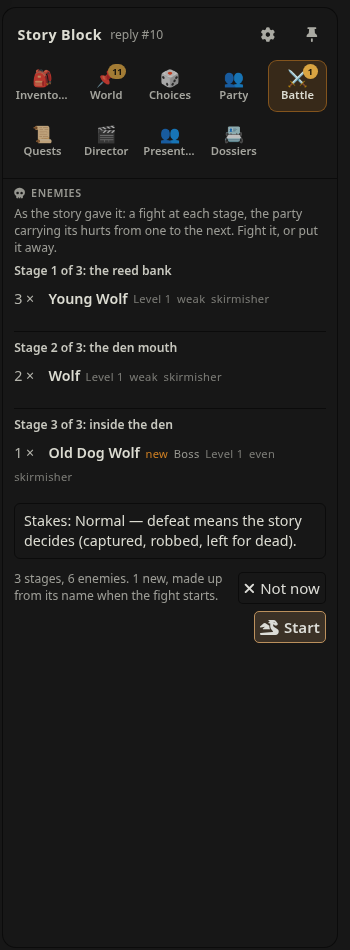
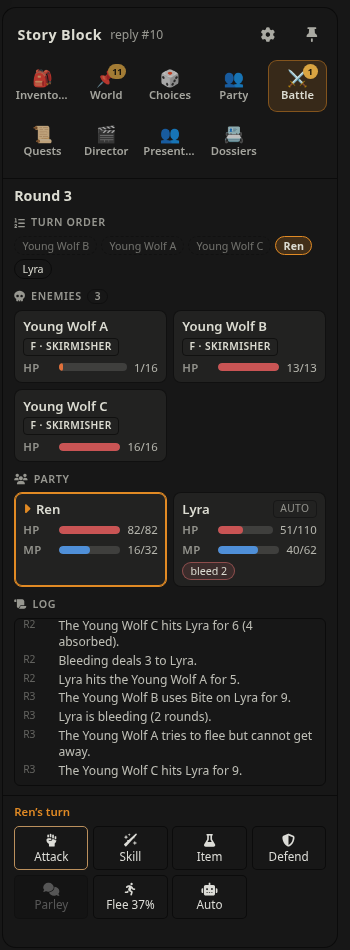
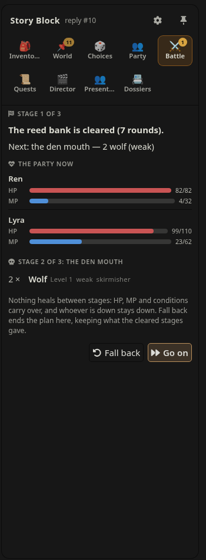
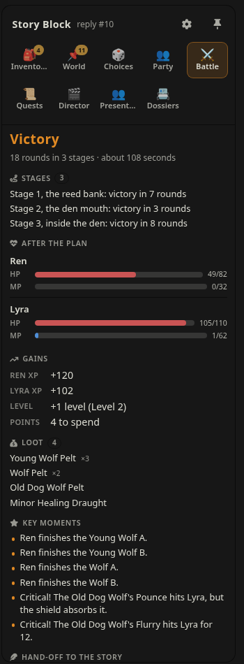
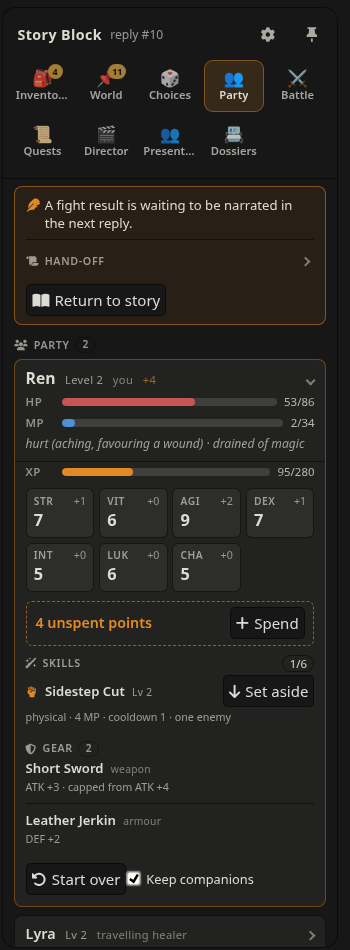
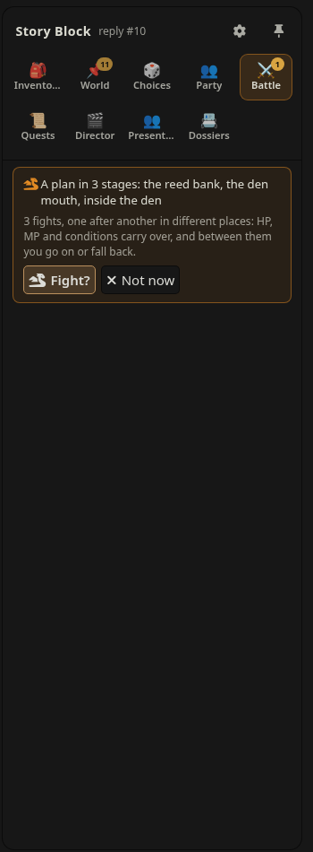
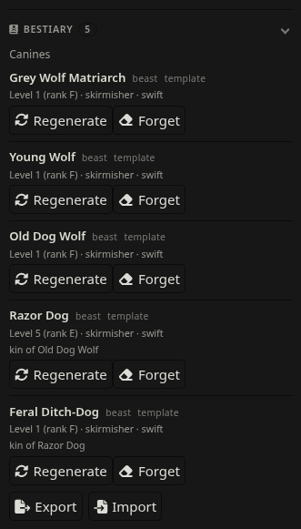
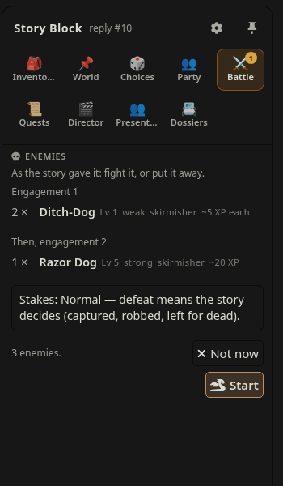
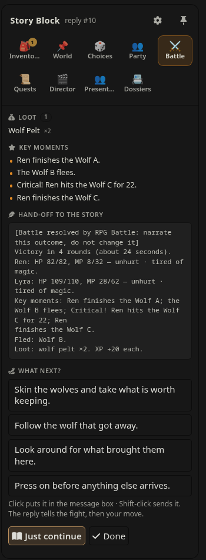

# RPG Battle v0.5.4

Turn-based fights for SillyTavern, resolved in code, and a party that grows with the story.
When the story starts a fight, RPG Battle offers it: **Fight?** shows the foes and the stakes as
the story gave them, **Start** begins it, you fight with buttons (**Attack, Skill, Item, Defend,
Parley, Flee, Auto**), and the story gets one short summary to narrate. No model calls during the fight, no arithmetic for the model, and a lost
fight cannot be rerolled by swiping.

The story drives, you decide: fights, rests, new skills, companions joining or leaving and XP
for what the party achieves all come from the story as **offers** you accept or put away. There
is no free fight, rest or skill on demand; code sets every number. A fight is the story's too:
you choose whether to fight it, not who you fight or what is at stake.

Needs [Story Block](https://github.com/kohz87/Story_block) **0.7** or newer. With
[Story Director](https://github.com/kohz87/Story_director) **0.7.2** or newer, HP and MP also come
back as story time passes; with **0.8**, the fights it plans are offered when the story reaches
them.

## Screenshots

A three-stage plan from a demo session with [Story Block](https://github.com/kohz87/Story_block), [Story Director](https://github.com/kohz87/Story_director) and [NPC State Delta](https://github.com/kohz87/npc_state_delta). The story wrote `<Encounter>at the reed bank: 3 young wolf (weak); then at the den mouth: 2 wolf (weak); then inside the den: old dog wolf (boss, even)</Encounter>`.

| The plan, as the story gave it | A fight | Between stages | The result |
| --- | --- | --- | --- |
|  |  |  |  |

| The party (Ren and Lyra) | The offer in the Battle tab |
| --- | --- |
|  |  |

| Monster families: the Bestiary | Levels, threat and XP per foe |
| --- | --- |
|  |  |

A new kind in a family the story already knows (a razor dog after the wolves) is made up as **kin** of its relative: same behaviour, moves and kind of loot, its own level and XP.



**What next?** after a fight: a click puts a move in the message box, Shift-click sends it. Optional (*Next moves after a fight*).

## Install

1. Install Story Block 0.7+ and enable it.
2. **Extensions → Install extension**, paste `https://github.com/kohz87/rpg_battle`, reload.
3. Story Block's sidebar gets a **Party** tab (always, while RPG Battle is on) and a **Battle** tab
   (only while there is a battle). Settings are under **Extensions → RPG Battle**.

## Your character

The first time you open the **Party** tab, you make your character: a name (your SillyTavern
persona's to start with; it follows a persona switch until you type another) and **10 points**
to spread over seven stats that all start at 5. That is all: there are no classes, and a new
character has **no skills**. Skills come from the story (see *The story's offers* and *For card
authors* below); without any, a character still attacks, defends, uses items, parleys and flees.

| Stat | Does |
|---|---|
| **STR** | Physical attack |
| **VIT** | Max HP and defence |
| **AGI** | Turn order, dodging, fleeing |
| **DEX** | Accuracy and critical hits |
| **INT** | Max MP, magic attack and resistance |
| **LUK** | Critical hits and loot |
| **CHA** | Parley in a fight; the social stat outside one |

Your sheet is the first section of the **Party** block, kept by RPG Battle: the model reads it
every reply (so it knows you are hurt, how strong you are and what you can do) and never writes
it. Your companions follow in the same block.

```
## Ren (you)
Level: 1 | XP: 72/100 | Points: 0
HP: 61/98 | MP: 15/32
STR: 9 | VIT: 8 | AGI: 6 | DEX: 7 | INT: 5 | LUK: 5 | CHA: 5
Checks: STR +2 | VIT +1 | AGI +0 | DEX +1 | INT +0 | LUK +0 | CHA +0
State: hurt (aching, favouring a wound) · tired of magic
Skills: Power Strike (Lv 2, 3/12) | Sweep (Lv 1, 4/5) | Shadow Step (Lv 1, 0/5)
Conditions: none

## Lyra — healer | control: auto
Level: 3 | XP: 0/100 | Points: 0
HP: 138/138 | MP: 80/80
State: unhurt
STR: 5 | VIT: 12 | AGI: 5 | DEX: 5 | INT: 16 | LUK: 5 | CHA: 5
Skills: Frost Lance (Lv 1, 2/5) | Mend (Lv 3, 9/22)
```

- **The Party tab** shows the party as cards: yours first and open, each companion folded to its
  name, level, HP and MP and State. Open, a card has the stats (with checks for you), the
  skills in use and set aside, the gear, and its controls. Which cards are open is kept while
  you play.
- **Levels:** XP from fights and from the story (*XP and levels* below); each level gives **4
  points** you spend yourself (**Spend** on your card).
- **Skills:** learned from the story (a `<Learned>` offer opens the learn form, prefilled; a
  library skill keeps its stat requirements, like INT 9 for Fireball). Using a skill in fights
  raises its mastery (Lv 1 to 5): 5 uses take it to Lv 2, 12 more to Lv 3, then 22 and 35
  (`masteryUses` in `rules.json`).
- **The Skills line** writes each skill's mastery and its uses toward the next level:
  `Power Strike (Lv 2, 3/12)` is mastery 2, 3 of the 12 uses to Lv 3; `(Lv 5, max)` at the top.
  The progress is in the block like everything else, so deleting, swiping or editing the reply
  that wrote a fight's result takes it back with the HP and XP. Lines from older chats
  (`Power Strike (Lv 2)`) read as no progress yet; a chat from before 0.4.1, which kept the
  progress out of the block, has it written into the block the first time it is open.
- **Skills in use:** a member fights with at most **6** skills (*Settings → Party*, 3 to 12).
  More are kept, **set aside** (a `Set aside:` line in the block), and swapped on the card with
  **Set aside** and **Use**. Learning one past the cap asks which sits out. An older sheet over
  the cap keeps its first six in use.
- **State:** your HP, MP and conditions in words (*unhurt*, *bruised*, *hurt*, *badly hurt*,
  *barely standing*, *down*; *tired* or *drained of magic*; *poisoned*…), worked out by RPG
  Battle. The model is told to portray you exactly as it says, so a character at a fifth of
  their HP is written bleeding and slow, not fighting on unbothered. Companions get one too.
- **Checks outside fights:** the **Checks** line in your section is your bonus per stat. With
  Story Block's Dice block on, the dice use it as the modifier (a CHA check is d20 + your CHA
  bonus).
- **Start over** (on your card, it asks twice): your sheet is cleared, and the companions too
  unless *Keep companions* is ticked; creation opens. Nothing is carried over; there is no
  respec.
- **Death:** losing a fight *to the death* ends your character's story. The sheet reads `State:
  dead`, the hand-off tells the model plainly, and the Party tab shows *Ren has died.* with
  **Start over**. Delete or swipe the reply that wrote it and it is undone, like any sheet change.
- **Party file:** *Party file → Export party* saves your character and companions (sheets, skills,
  gear) as JSON; **Import party** (there, and on the creation screen) loads one into this chat
  after you confirm. It is cleaned on the way in (names, bounds, max HP and MP worked out again,
  story-taught skills built again); your equipped gear in the file goes into the Inventory, not
  equipped, unless a row of that name is already there.
- **Persona rename:** switch your SillyTavern persona to another name while your character still
  has the old one, and the Party tab offers *Rename Ren to Kael?*, once.

Older chats kept your sheet in a separate **Character** block. RPG Battle still reads it, and
writes it into the Party block as your section the first time the chat is open; the old block is
no longer kept, shown to the model or given a tab.

## XP and levels

Every number is code's: the story only says what happened (a fight, how big an achievement was,
how hard a quest), never how much XP. **Every level needs 100 XP** (since 0.5.2; `xpBase` 100 and
`xpExponent` 0 in `rules.json`'s `character`, so a curve can be set again: before 0.5.2 it was
100 × level^1.5), and every gain is a share of **each member's own next level**, so with a curve
it would still mean the same at level 2 and level 40. Each 100 is one level, 4 points, the rest
carried over; companions level the same way.

**Fights (0.5.2).** Each defeated foe is worth, to each member:

- **a tenth** of the XP that member needs for their next level for an **even** foe (its level
  is theirs);
- **× the band of the level gap** (foe − member, in plain levels, also with tier titles; 0.5.3):

  | Gap | Threat | Factor | XP |
  | --- | --- | --- | --- |
  | +8 or more | deadly | ×4 | 40 |
  | +4 to +7 | strong | ×2 | 20 |
  | −3 to +3 | even | ×1 | 10 |
  | −4 to −7 | weak | ×½ | 5 |
  | −8 or less | trivial | ×¼ | 3 |

  (`xp` in `rules.json`: `even`, `bands`, `below`). A foe with a level of its own shows the
  threat its gap is ("Lv 9 · deadly");
- **×3** for a boss; **half** for a foe won over by **Parley** instead of beaten;
- **× your XP rate** (below); rounded, at least 1.

Every member gets the full amount for every foe: XP is **not split** across the party, and a
companion at another level counts it against their own. With 100 to a level that is, at any
level, **10** for an even foe, **5** for a weak one, **3** for a trivial one, **20** strong, **40**
deadly, **30** for an even boss and **5** for an even foe talked down. Fleeing gives nothing for
the foes left standing. The setup shows each line's worth for your character (*~10 XP each*).

**The story and quests.** An `<XP>` award is a share of each member's next level: **minor** 10 %,
**major** 25 %, **milestone** 50 % (10, 25 and 50 XP); a quest Story Director closes **easy** 5 %,
**normal** 10 %, **hard** 15 %, **nightmare** 25 % (5 to 25 XP) (*The story's offers*, below).

**XP rate** (*Settings → Party*, 1 by default, 0.25 to 5 in steps of 0.05) multiplies all XP:
fights, parleys, story awards and quests. The offer, the result screen and the hand-off show the
multiplied amount. A fight already under way when you change it counts at the new rate.

**Progress** is XP within your level against what the next one needs, `30/100`, also with tier
titles (*Soul Class I (Lv 1)* beside `Soul Growth 30/100`), and gains read `+30` everywhere. At
the level cap it shows **MAX**. Progress is written as whole numbers; an odd value in a block
(`45.20/100`, `140/280`) is read as its first number, rounded and kept below the level's 100, so
nothing levels up just from being read.

## Your world's terms

Your lorebook may not say "Level" and "XP". Under **Extensions → RPG Battle → Terms** you name
them, and the sheets, the Party and Battle tabs and the fight summaries use your words (the numbers stay
the same):

- **Level name** (`Level` by default): *Rank*, *Circle*, *Soul Power*, *Soul Class*…
- **XP name** (`XP` by default): *Experience*, *Power Growth*, *Soul Growth*…
- **Tier titles** (off by default): levels 1–10 are *Soul Class I*, 11–20 *Soul Class II*… (the
  tier size and Roman or Arabic numerals are yours). Progress is still XP within the level
  (since 0.5.2; it was the share through the tier before).
- **Level cap** (99 by default): no level past it; XP stops there and shows **MAX**.

With tier titles on, the level line of your section reads

```
Soul Class: III (Lv 24) | Soul Growth: 54/100 | Points: 2
```

and with names of your own but no tiers `Soul Power: 24 | Power Growth: 54/100 | Points: 2`.
The exact level always stays in the block, so changing or turning off the terms never loses a
sheet. With your own terms, the fight setup and the fight cards show an enemy's power as one of
your tiers (or levels) instead of F to SSS, a story's `<Encounter>` may name one (`3 wolf (Soul
Class I)`), and a won fight says `Soul Growth +38` (or `Power Growth +38`).

**Story Block's own Character Sheet block** (a template with an HP meter the model writes) does
the same job by guesswork. With both on, the story reads two HP values that disagree, so the
Party tab and RPG Battle's settings say so, with a **Turn it off** button. It is never turned
off for you. If you keep both on purpose, choose **The other one** for *Stats* under **Source of
truth** (below) and the notice goes away.

## Recovery

HP and MP come back the way the story says; there is no rest button, since a free heal on demand
would be a cheat:

- **As story time passes** (with Story Director): after each reply, the time it moved on from
  the reply before heals the party, **5 % of max HP and MP per hour**; **6 hours or more** is a
  full rest (fight conditions like poison end). A note in the Party tab says what happened
  ("8 hours passed: Ren is fully rested."). It is written into that reply, so a swipe or an edit
  recomputes it instead of adding it twice. Switch: *Recover HP and MP as story time passes*.
- **A rest in the story:** when the party rests, the model adds `<Rest>short: an hour by the
  fire</Rest>` or `<Rest>long: slept at the inn</Rest>`, offered as *Rest (long): slept at the inn.
  Recover?* **Recover** gives your character and every companion a **short rest** (a quarter of
  max HP and MP) or a **long rest** (full; fight conditions end). Not offered during a fight, while
  a fight result waits to be narrated, or for the reply that narrates one.
- **No double counting:** a rest and story time in the same reply are one stretch of time. A short
  rest adds only what its quarter gives beyond what the clock already gave that reply (the result
  is the larger of the two, not their sum; wounds taken in the reply stay taken); a long rest
  fills everything, which makes the clock's part moot.
- **Use item:** a consumable used outside a fight (`heal 30`, `mp 20`, `cure poison`) on you or a
  companion; it comes off the inventory. Damage items stay for fights.

A character at 0 HP cannot start a fight until they recover.

## Story wounds

The story hurts people between fights too: a fall, a poisoned cup, a healer's poultice. While
you have a character, the model is told (in one instruction of about 185 tokens with every hidden
block below) to add a hidden **Wounds** block when that happens to someone on the Party sheet, one
line each, in words, never numbers:

```
<Wounds>
Ren — wound: fell down the ravine
Astra — poisoned: a dart in the dark
Ren — heal scratch: a poultice
Astra — cure poison: an antidote
</Wounds>
```

| Word | Share of max HP |
|---|---|
| **scratch** | 10 % |
| **wound** | 30 % |
| **severe** | 50 % |
| **grievous** | 80 % |

- **Harm** can take someone to 0 HP (down); **heal** (or *healed*, *treated*) gives the same share
  back, never above max. Any other word (*poisoned*, *exhausted*, *bleeding*) adds a condition;
  **cure** removes one. The shares are `wounds` in `rules.json`.
- **One blow per person per reply:** the first harm or heal line for someone counts, the rest are
  ignored; conditions may come alongside.
- **Names** are yours or a companion's, in any case, also by first name ("Ren" is Ren Aldane).
  Anyone else (an NPC) is left to the story.
- **Applied after the reply, into that reply**, after story-time recovery, from the sheets before
  it: a swipe recomputes it and a continue does not add it twice. Not during a fight, and not in
  the reply that narrates one (the fight already dealt its wounds).
- **Undo:** a toast says what happened ("Ren: wound (−29 HP), fell down the ravine.") with an
  **Undo** button, and the Party tab shows the same line with **Undo** while that reply's sheets
  are still the ones it wrote (after a rest, an item or a fight, they have moved on). Undo keeps
  the recovery and the wounds stay undone for that reply.

The Wounds block never shows in the story: Story Block hides it with its other blocks.

## The story's offers

Besides `<Wounds>` and `<Encounter>`, the model is asked for these hidden blocks, each only when
the story makes it true (Story Block hides them with its other blocks):

| Block | Offer | Accept |
|---|---|---|
| `<Joins>Lyra — healer, level 6</Joins>` | *Lyra joined. Add as companion?* | Opens **Add companion**, filled in (see *Companions*) |
| `<Leaves>Lyra: returned to her village</Leaves>` | *Lyra left the party. Remove?* | Removes her |
| `<Learned>Lyra — Frost Lance: ice magic, hits all</Learned>` | *Lyra learned Frost Lance. Add it?* | Opens the learn form, filled in |
| `<XP>major: rescued the caravan</XP>` | *XP +25: rescued the caravan. Award?* | XP for the whole party |
| `<Rest>long: slept at the inn</Rest>` | *Rest (long): slept at the inn. Recover?* | A rest (see *Recovery*) |
| A quest Story Director 0.8.2 closes in the reply | *Quest done: The Lost Caravan (hard). Award XP +15?* | XP for the whole party |

- **Offers, never applied on their own:** each shows as a toast with its button and at the top of
  the Party tab with **Accept** and **Not now**. They belong to their moment: a reply's offers
  (and a quest it finished) last only while it is the latest reply and no fight has started since
  it, so a rest from before a fight can never heal after it. A swipe recomputes them, and one put
  away stays away for that reply's text. The opening message's skills and companions are the
  exception: they wait until taken or put away.
- **Names** match by full or first name, as story wounds do; `You` (or your character's or
  persona's name) is you. A name nobody in the party has is ignored, except in `<Joins>`.
- **Learned:** the type, stat, target and effect (fire, ice, lightning, poison) are guessed from
  the words and can be changed; code sets power, MP and cooldown for the learner's level. A
  library skill's name is the library skill, with its stat requirements (the form says why one is
  out of reach). At the cap of skills in use, it asks which to set aside.
- **XP awards** are a share of the XP the member needs for their next level, each at their own
  level, so they mean the same at level 2 and level 40: **minor** 10 %, **major** 25 %,
  **milestone** 50 %; a quest **easy** 5 %, **normal** 10 %, **hard** 15 %, **nightmare** 25 % (by
  Story Director's quest difficulty; none given is normal), times your XP rate; the offer shows
  that amount. Nothing at the level cap. They level up exactly as fight XP does. `xpAwards` and
  `questXp` in `rules.json`.
- **Not from the reply that narrates a fight** (XP and rests: the fight gave its own), and no rest
  while a result waits to be narrated. Nothing at all during a fight.
- **Also offered:** a companion who fell in a fight to the death (*Lyra fell. Remove from the
  party?*, it asks twice) and your persona's new name. A companion's NPC renamed in NPC State
  Delta is followed on its own (below).

## For card authors: starting skills and companions

A new character has no skills; the story's **opening message** (the character card's greeting,
whichever greeting or swipe is shown) gives them, and can bring companions along. Its hidden
blocks are read like a reply's and offered the same way. Lines for your character wait until it
is made (or imported), then appear in the Party tab; a `<Joins>` can be accepted before or after.

```
The caravan master waves you over. "Lyra here patches up my drivers. Mind your blade."
<Learned>
You — Shadow Step: dash behind a foe | type: physical, stat: AGI, target: one, effect: stun
You — Power Strike: a heavy blow
</Learned>
<Joins>Lyra — healer, level 3 | focus: INT, VIT | skills: Frost Lance, Mend</Joins>
```

- **Hints** after a bar make it exact: `type` (physical, magic, heal, buff, debuff), `stat`
  (STR…CHA), `target` (one, all, self, ally, allies), `effect` (fire, ice, lightning, poison);
  for `<Joins>`, `level`, `focus` (up to three stats, first weighs most) and `skills`. Unknown
  words are ignored, and code still sets every number.
- A skill from the opening message comes **without stat requirements** (the card says the
  character starts with it); it still counts toward the skills in use.
- Story Block hides the blocks when it normalizes a message (on receive, render, swipe and
  edit); if a greeting shows them raw, Story Block's **Rescan** tidies it.

## Equipment and loot: your Inventory block

RPG Battle reads equipment from Story Block's **Inventory** block. Mark what you wear as
`equipped` and give it a rarity and stats:

```
[Equipment > Weapons]
Iron Longsword | 1 | equipped · uncommon · ATK +6, DEX -1
[Equipment > Armour]
Studded Jerkin | 1 | equipped · common · DEF +4
[Consumables]
Healing Draught | 2 | heal 30
```

- **What counts in a fight:** one weapon, one off-hand (none with a two-handed weapon), one
  armour, **one worn piece** (helm, gloves, boots, belt…) and **two accessories** (rings,
  amulets, charms…). Equip more and only the first of each, in inventory order, counts; the
  **Gear** list on your card shows what the fight uses and names the rest as *not counted* (and
  why). **Settings → Equipment** changes how many worn pieces and accessories count (0 to 9).
  The slot comes from the item's kind, its category (`[Equipment > Boots]`) or `slot: worn` /
  `slot: accessory` in its note.
- **Stats are limited by rarity and your level** (common < uncommon < rare < epic < legendary),
  so an item the model makes up cannot carry "ATK +50": in a fight it is scaled down to what its
  rarity allows, and the Gear list on your card shows it as capped ("STR +2 · capped from STR +20"). An item without stats gets them from its
  rarity and kind.
- **Consumables** with an effect (`heal 30`, `mp 20`, `cure poison`, `fire 25, all enemies`) can
  be used in a fight; what you use comes off the inventory afterwards.
- **Loot** from a won fight is written into the inventory, money into your money row. Only foes
  that would carry coin drop money: people (bandits, cultists, goblins, orcs…), their leaders and
  casters, and a drake or wyvern that is a boss, on its hoard. Beasts, insects, oozes, plants,
  constructs, spirits and the dead leave something of themselves instead (a *Wolf Pelt*, a
  *Fang*, *Spider Silk*, *Slime Jelly*, *Old Bone*), and more often than a coin carrier leaves
  its materials. The shipped bestiary marks each creature (`coins: true`, `false` or `'boss'`); a
  made-up one goes by its kind. A boss rolls for gear and consumables more than once, but its
  body parts only once, and a part a creature has one of (a pelt, hide, head, heart, tail, skull,
  horn…) is never more than one per creature: one wolf, one pelt. Fangs, claws and scales may
  come several at a time.
- **Give item** (on a companion's card) moves one equipment row from your Inventory onto their
  gear (the Equipped line of their section; the same slot limits and rarity caps, at their
  level); **Take back** puts a piece back into your Inventory, not equipped.

## A fight

Fights start from the story only: a reply's `<Encounter>`, or a fight Story Director planned
(see below). There is no Start fight button. The **Battle** tab exists only while there is a
battle: the offer, the setup, the fight, and its result until it goes back to the story.

1. **The offer:** *A fight is starting: 3 bandit, bandit captain (boss)*, **Fight?** or **Not now**
   (also as a toast). **Fight?** opens the setup.
2. **Setup**: the engagement as the story gave it, to fight or not, never to change. Each line
   shows how many, the name (tagged **new** when nobody knows it: it is made up when the fight
   starts, see *Monsters on the fly*), **Boss**, its level in your terms (the bestiary's own, the
   story's threat word turned into a level, or a fair one for your level), the threat word, its
   role and what one is worth to you (*2 × Feral Ditch-Dog · Lv 1 · weak · skirmisher · ~5 XP
   each*); later engagements are listed in order. The stakes are said, not chosen: *Stakes: Normal* (defeat
   means the story decides: captured, robbed, left for dead) or *Stakes: To the death* (defeat
   is death: game over), as the story marked it. **Start** or **Not now**.
3. **Fight**: each foe's card shows its level, the story's threat word and its role (*Lv 1 · weak
   · skirmisher*). On your turn pick an action and tap a target. Enemies (and companions on *auto*)
   act on their own, by simple predictable rules. **Auto** plays the rest of the fight for you.
4. **The result**: outcome, HP and MP left, XP, loot and the key moments are applied to the
   sheets and inventory (companions on auto spend new points by their build), and a short
   summary waits for the next reply:

```
[Battle resolved by RPG Battle: narrate this outcome, do not change it]
Victory in 5 rounds (about 30 seconds).
Ren: HP 61/98, MP 15/32.
Key moments: Ren finishes the Goblin A; Critical! Ren's Power Strike hits the Goblin Shaman for 34.
Loot: 1 silver, 3 copper, a goblin ear, a shaman's charm. XP +35.
```

**What next?** (since 0.5.4) Under the result, a few things your character could do next: *Skin
the wolves and take what is worth keeping*, *Tend to Lyra's wounds before moving on*, *Follow the
ones that got away*. With model calls on (Generated words), one short call writes them from the
hand-off and the scene (a 15-second limit, on the same model as new creatures); off, offline or when
the call fails, they are written from the result itself (loot, someone hurt, foes that fled, a lost
or abandoned fight, stages not reached). A click puts one in the message box to edit and send,
Shift-click sends it at once; the reply then tells the fight and your move. **Just continue** sends
the usual message. Never after your character's death. Off under **Blocks → Next moves after a
fight**.

**Return to story** sends a short message for you so the narration comes straight away. The
summary is given to that one reply only; its swipes narrate the same result. **Done** closes the
Battle tab; while the summary waits, the Party tab shows it with **Return to story**. Once the
reply that narrates it is in, the notice goes (and the story's next fight can be offered); delete
that reply and the result waits again. There is no Discard: a fight's result always reaches the
story, so the sheets and the narration agree. A fight belongs to the reply it started from (since
0.4.3): delete back past that reply, or swipe it, and the fight and its result are gone with it,
so replaying the scene can offer a new fight. Since 0.5 that holds even when the very same reply
comes back in its place: the fight is offered again, and a Not now said to the deleted reply does
not hide it. The reply that narrated a fight never offers XP or a rest for it, however the story
moves on afterwards.

A plan (fights in stages, below) has one result too: the result screen lists each stage (*Stage 1,
the gate: victory in 3 rounds*, *Stage 3, the tower: not reached*) above the totals, and the
hand-off has a line per stage reached and says plainly what never happened:

```
[Battle resolved by RPG Battle: narrate this outcome, do not change it]
Stage 1, the gate: victory in 3 rounds.
Stage 2, the yard: defeated — the story decides what follows (captured, robbed, left for dead).
Not reached: the tower. Do not narrate it.
Ren: down (unconscious or unable to fight).
Key moments: Ren finishes the Guard A; …
Loot: 1 silver, 2 copper. XP +30.
```

After **Fall back** the line is *Fell back after the gate; the yard and the tower were not
attempted.* The member lines are the end state; the loot and XP are what the cleared stages
gave.

## Fights from the story

When a fight breaks out in the story, the model adds a hidden **Encounter** block naming the
foes and stops at the first blow, so the fight itself is yours to play:

```
<Encounter>3 bandit, bandit captain (boss)</Encounter>
```

A toast and the Battle tab (which appears for it) offer it: *A fight is starting: 3 bandit,
bandit captain (boss)*, **Fight?** or **Not now**. **Fight?** shows it as it will be fought (three
Bandits, one Bandit Captain as a boss, normal stakes), read-only; **Start** fights it. Nothing on
the page can change the fight: RPG Battle builds it from the block it read. **Not now** puts the
offer away for that reply. Groups are separated by commas, `and` or new lines; each is a count
(`3`, `3 x`, `two`, `a`), the name, and optionally `(boss)`, `rank D` and a role. A plural is made
singular when the bestiary knows the creature ("3 bandits" → Bandit) or its last word is a
creature word ("3 bog wights" → Bog Wight); any other name is kept.

The model may also say **how dangerous** a foe is, relative to the party, in one word:

```
<Encounter>3 marsh wolf (weak), wolf matriarch (boss, strong)</Encounter>
```

| Word (and its synonyms) | Power |
|---|---|
| **trivial** (feeble, puny) | 2 steps below the party's level |
| **weak** (minor, easy, low, lesser) | 1 step below |
| **even** (fair, matched, equal) | the party's level |
| **strong** (tough, dangerous, high) | 1 step above |
| **deadly** (lethal, overwhelming, elite, calamity) | 2 steps above |

A step is **4 levels**, also when your terms have tier titles (0.5.3: a strong foe is a few
levels up, not a tier up; `threat` in `rules.json`). No foe goes below level 1: where the word
would put it there (*weak* up to level 4, *trivial* up to level 8), it stays at level 1 and is
**made smaller** instead, its HP and attack ×0.88 for each level it falls short, never below
×0.35, its defence as it is; its XP counts from the level the word meant (so *weak* is still
half an even foe's XP and *trivial* a quarter). At level 1 a *weak* wolf has 10 HP to an even
one's 16 and is worth 5 XP to 10; a *trivial* one has 6 HP and is worth 3. Only a level that
came from the word is treated so. The word goes in brackets, or before the name for the
unmistakable ones
(`3 weak marsh wolves`; "Lesser Demon" and "High Priest" stay names). A power written outright
(`rank D`, `level 12`, `Soul Class II`) wins over it; with neither, the fight is even.

**Engagements back to back:** `then:` starts the next engagement, fought once the one before is
done, with no rest between:

```
<Encounter>3 bandit; then: bandit captain (boss)</Encounter>
```

It is one battle: HP, MP and conditions carry over, and there is one result and one hand-off at
the end. The setup lists each engagement in order; up to three after the first.

**Plans: fights in stages (0.5).** When the party's plan, or the story, takes it from one fight
to the next somewhere else, a place after `then` starts a new **stage**:

```
<Encounter>at the gate: 2 guard (weak); then at the yard: 3 guard (even); then at the tower: guard captain (boss, strong) | to the death</Encounter>
```

`at the gate:` before the first group names the first stage (optional: without it the stage is
just *Stage 1*); `then at the yard:` starts the next one (also `then, at the yard:` and `and then
at the yard:`, any case). Any short place works the same way: `then inside the den:`, `then
across the ford:`, `then the tower:` (one to six words before the colon, no digits); a leading
*at* is left out of the place's name, other words stay. A plain `then:` is still more foes
joining the same fight, so a stage may have its own waves. Up to five stages. The offer reads *A plan in 3 stages: the gate, the
yard, the tower* (*— to the death* when it is marked: the stakes are the whole plan's). The setup
lists each stage in order, *Stage 1 of 3: the gate*, with its foes as for any fight, read-only:
**Start** or **Not now**.

Each stage is its own fight: new foes, the rounds counted from one. The party goes in as the last
stage left it: HP, MP, cooldowns, conditions and the items left carry over, nothing heals, and
whoever is down stays down. After a stage is won the Battle tab says *The gate is cleared (3
rounds). Next: the yard — 3 guard (even)*, with the party as it stands and the next stage's foes,
and two buttons only: **Go on** (the next stage) or **Fall back** (the plan ends there, a
withdrawal). The plan ends with victory when the last stage is won, with defeat at the stage lost,
fled at the stage you escaped from, or withdrawn on Fall back; the stages after it never happen.
It is kept with the chat (a reload finds it where you left it, between stages too) and belongs to
the reply it started from: delete or swipe that reply and the plan and its result are gone.

What every cleared stage gave is kept, even when a later one goes wrong: XP for the foes beaten in
each stage (also in the one lost, as after any lost fight) and the loot of each stage won, by the
same rules as one fight (levels, companions' auto-spend, items used, the Inventory). Losing any
stage of a plan to the death is losing a fight to the death. Nothing is written until the plan
ends; then everything is written once, into the latest reply.

**The stakes:** a fight to the death is marked after a bar, at the end of the block:

```
<Encounter>3 bandit; then: bandit captain (boss) | to the death</Encounter>
```

Defeat is then death (game over, and the hand-off says so). `| death` and `| stakes: death` work
too, in any case; without a mark the stakes are normal (defeat means the story decides). What
follows a bar is never read as a foe.

With Story Director 0.8, a fight it has planned (a beat with foes, now due or due soon) is
offered the same way, with its name and place; its text may use `then:`, `then at <place>:` and
`| to the death` too.

## Monsters on the fly

The bestiary knows twenty creatures; the story knows many more. A name it does not know is
**made up when its fight starts**, automatically:

1. **From a template** (free, instant). The name's words pick one: *beast* (wolf, hound, boar,
   bear…), *undead* (ghoul, wight, skeleton, lich…), *humanoid* (bandit, thug, soldier, knight…),
   *leader* (a captain, chief, warlord or lord of them), *caster* (shaman, witch, mage, priest…),
   *construct* (golem, sentinel, automaton…), *ooze* (slime, jelly), *insect* (spider, scorpion,
   wasp…), *drake* (drake, wyvern, dragon, lizard…), *spirit* (ghost, wisp, elemental…), *plant*
   (treant, vine, shambler…), or a plain fallback. What it is beats what it does (a *skeleton
   mage* is undead that casts), and a leader word on any kind makes it a leader of its kind (a
   *wolf matriarch* is a beast with a leader's nerve). The template gives it a role, **traits**
   (*armoured*, *swift*, *slow*, *frail*, *hulking*, *fierce*, *venomous*, *fiery*, *savage*,
   *chilling*, *regenerating*), whether it **talks** (people and casters do; beasts, the dead,
   constructs and oozes do not), a **temperament** (*relentless*, *mindless*, *disciplined*,
   *proud*, *cunning*, *wild*, *cowardly*: its morale in a parley and when it flees), **two or
   three skills** of its kind (*Bite*, *Pounce*, *Howl*; *Bone Claw*, *Grave Chill*…), built
   by the skill machinery at the power it is fought at, and a **loot table** of its kind
   (*Marsh Wolf Pelt*, *Wolf Fang*, now and then a *Wolf-fang Charm*) whose gear rarity follows
   its power.
2. **Flavoured by the model** (on by default, one short call per new creature, at most four per
   fight). The model gets the name, its power in your terms, the template and the last few
   hundred words of the story, and answers in **words only**:

   ```
   look: a drowned knight in rusted mail, marsh-light swinging from its ribs
   traits: armoured, slow
   talks: no
   temperament: relentless
   skills: Drowning Grip — grab, weaken; Marsh Stench — all foes, poison
   loot: bog-iron shard (common), wight's lantern (rare, MATK)
   ```

   Code maps the words onto the template's knobs (known traits, conditions, targets and stat
   names only), renames the skills and the loot, and works every number out again from the
   rules. A number the model writes is ignored, so is a word it does not know, and a rarity is
   at most one step above what the creature's power drops. If the call fails, times out (30
   seconds for all of a fight's creatures) or there is no model, the creature stays the
   template one, silently (a note in the console). The setup says *Preparing foes…* meanwhile.

The creature is then **kept in the chat** (its metadata), so the same name is the same creature
for the rest of the story, with its own level when a later fight names no power. Names are
looked up in this story's creatures first, then the shipped bestiary, and only then made up.
A name worded differently still finds its creature (since 0.5.1): describing words (young, old,
mangy, feral, grey, alpha, matriarch…) are left out, so "mangy young wolf" is the story's Young
Wolf and "wolf matriarch" its Grey Wolf Matriarch, while a word that names a kind keeps it apart
("Dire Wolf", "Bog Wight", "quill-dog"). The story's wording is what the fight shows. The story
instruction also lists the last eight creatures this story has met, so the model writes the same
creature by the same name.

**Kin (0.5.2).** A new kind in a family the story already has is made as **kin** of its closest
relative rather than from the bare template: with a *Feral Ditch-Dog* in the story, a *razor
dog*, a *wolf dog* or a *hellhound* is its kin. A creature's family comes from its creature noun
(dog, hound, wolf…; also as a plural or the end of a compound, *ditch-dog*, *hellhound*):
**canines** (dog, hound, wolf, cur, mutt, jackal, fox, coyote, warg), **felines** (cat, lynx,
panther, leopard, lion, tiger), **ursines** (bear), **rodents** (rat, mouse), **arachnids**
(spider, scorpion), **serpents** (snake, serpent, viper, adder, wyrm), **avians** (bird, crow,
raven, hawk, eagle, vulture), **insects** (beetle, wasp, ant, centipede), **oozes** (slime, ooze,
jelly); any other noun is a family of its own. The closest relative shares the noun if one does
(a *wolf dog* is a dog's kin before a wolf's), else the family; the story's own creatures before
the shipped ones, the newest first. Kin takes the relative's template, role (unless its own name
says one, *dog archer*), temperament and traits, whether it talks and carries coin, its moves to
start from (the template may add one), and its loot with the body parts renamed (*Razor Dog
Pelt*, *Razor Dog Fang*; one pelt per creature as always). Its level, numbers and XP are its
own row's. A flavour call is told it is a relative of the Feral Ditch-Dog, so its look fits. A
name that already finds its creature (exactly, or differently worded) is that creature, never
kin. With no relative, a new kind is made from its template as before.

- **Setup:** a name nobody knows is tagged **new** (made up when you press **Start**; its tooltip
  says *made up as kin of Feral Ditch-Dog* when it will be); in the fight, its card is too (its look is
  the card's tooltip).
- **Bestiary** (a fold at the bottom of the Party tab): this story's creatures, grouped by family
  (*Canines*, *Wights*…), with their power in your terms, role, traits and look, and *kin of
  Feral Ditch-Dog* on a kin; **Regenerate** makes one again (and flavours it again),
  **Forget** drops it (the name is made up anew next time). **Export** saves the list as JSON,
  **Import** adds one (cleaned like anything stored: known words only, every number worked out
  again).
- **Settings → Generated words:** model calls on or off (for new creatures and a new companion's
  skills), the model (the chat's own, or a connection profile, as in Story Director; a small fast
  one is enough), and the answer length (400 tokens).

## Money

Your lorebook names the money, so the currency is a setting: **copper / silver / gold** (rates
editable), **one coin** named as you like, or **your own** names and rates (for example
`bits=1, marks=12, crowns=20`). Loot is added to the inventory row named in the setting
(`Coins` by default).

## Companions

Companions join from the story. A `<Joins>Lyra — healer, level 6</Joins>` is offered as *Lyra
joined. Add as companion?*; **Add as companion** opens the form, filled in:

- **Name, role** (free words), **level** (the story's, fixed; with none given, at most yours) and
  who controls them (*Acts on its own* or *I command it*).
- **Focus:** up to three stats in order; every point they have (the starting 10 and 4 per level
  after the first) is spread over them by weight, 3, 2 and 1 (none: evenly). Role words fill it
  in, from a small table of generic words, and you can change it: *healer, cleric, priest* → INT,
  VIT, CHA; *mage, wizard, sorcerer, caster* → INT, DEX; *warrior, knight, fighter, guard* → STR,
  VIT; *tank, defender* → VIT, STR; *rogue, thief, assassin, scout* → AGI, DEX, LUK; *archer,
  ranger, hunter* → DEX, AGI; *bard, diplomat, merchant* → CHA, LUK; *monk, brawler* → STR, AGI.
- **Skills:** worked out from who they are by one short model call, in words only (name, a few
  words, type, stat, target, effect from fixed lists), as a made-up creature is flavoured (the
  *Generated words* settings, 30 seconds at most). Code builds each one for their level and sets
  every number. With the calls off, no model, a failure or too little in the answer: two or
  three library skills that fit the focus and role. The form shows them with **Generate again**
  and a remove button per skill; a `| skills: Frost Lance, Mend` hint names them instead. Later
  skills come from `<Learned>`, like yours.
- **Equipment** is never typed in: once they join, **Give item** on their card moves gear from
  your Inventory (slot limits and rarity caps as for yours).
- **From the story's NPCs** (with NPC State Delta 1.2.2): pick one of the chat's NPCs to fill in
  name, role and focus (from its role and summary; the skills are generated again for them). The
  companion stays linked: **Dossier** on their card opens the NPC's dossier, and when the NPC's
  name changes there, the companion takes it (*Lyra is now Lyra Vance (from NPC State Delta).*),
  once per change, written into the latest reply like any sheet change (delete that reply and
  they are Lyra again, and stay so). A `<Joins>` naming a known NPC is linked and refined the
  same way.

They live in the **Party** block after your section, fight beside you (on their own, or on your
command: tap to switch), level from fights and XP awards like you (each at their own level),
rest and recover with you. A companion on *auto* spends the points a level gives in proportion to
their build so far (*Settings → Party → Spend companions' points automatically*, on by default);
one you command, or everyone with the setting off, keeps them for **Spend** on their card.
**Edit** changes a companion's name, role and control (sheet, skills, mastery progress and gear
stay); **Remove** asks twice; a `<Leaves>` offers it. A companion at 0 HP when
a fight *to the death* ends **fell**: the Party tab offers to remove them (it asks twice). At
normal stakes they are only down, as before.

## With the other extensions

RPG Battle works alone (with Story Block). Beside Story Block, Story Director and NPC State Delta,
the extensions find each other through the **Story Suite** handshake and agree on who is the
source of truth for each area, so the model is not told the same thing twice; see
[docs/STORY_SUITE.md](docs/STORY_SUITE.md).

- RPG Battle offers **stats** (HP, MP, stats, skills, fights) and **rolls** (the Checks line as
  the Dice modifier), and **items** after Story Block's Inventory (it reads gear from it and
  writes loot into it either way).
- It shares its party with the others: your character and each companion with their level (in
  your terms), HP, MP and State words, as the sheets say.
- **Story Block 0.9.1** keeps the Party block without a sidebar tab of its own (`tab: false`), so
  RPG Battle's Party tab is the one party tab. With an older Story Block the block keeps its tab
  as before.
- **Story Director 0.8.2:** a quest it closes in a reply is offered as XP by its difficulty
  (`questsDoneAt`). Without it, nothing.
- **NPC State Delta 1.2.2:** its NPC profiles fill in a new companion (`npcProfiles`), and a linked
  companion's **Dossier** opens it (`openDossier`). Without it, the form has no NPC picker.
- **Story Suite's overlay** can show what RPG Battle adds to the next reply (`api.manage.tokens()`,
  an estimate: the story instruction or a waiting fight hand-off; the Party block is Story Block's
  to count).
- **Settings → Source of truth:** for *Stats*, *Roll modifiers* and *Items*, **Automatic** (the
  specialist for the area), **This extension** or **The other one**, with who the story follows
  now. For *Stats*, it decides whether Story Block's Character Sheet is pointed out as a second
  HP: with **The other one** the notice stays away, and RPG Battle still keeps its own sheets for
  its fights. With RPG Battle alone, every choice works like Automatic.
- **Story Suite overlay:** with two or more installed, Story Block's *Story Suite* overlay sets
  the source of truth for all of them in one table and switches RPG Battle on or off; *Manage all
  in Story Suite* at the top of RPG Battle's settings opens it
  ([docs/STORY_SUITE.md](docs/STORY_SUITE.md#one-place-to-manage-them-all)).

## Settings

Under **Extensions → RPG Battle**: the on/off switch and *Recover HP and MP as story time passes*
on top, then folds: **Money**, **Equipment** (worn pieces and accessories that count), **Terms**,
**Generated words** (model calls for new creatures and a new companion's skills), **Party**
(skills in use per member, 3 to 12; companions' points spent automatically; the **XP rate**, 0.25
to 5, multiplying all XP), **Source of truth**
and **Blocks** (the Party and Inventory tags, the Return to story message, next moves after a
fight on or off).

## Development

Plain ES modules, no dependencies, Node.js 24:

```sh
npm run check   # syntax check
npm test        # node:test suites, including a balance simulation
```

The design is in [docs/DESIGN.md](docs/DESIGN.md), the module contract in
[docs/ARCHITECTURE.md](docs/ARCHITECTURE.md).

## License

To be decided (Story Block and Story Director are GPL-3.0). Mirage RPG Suite, whose rank tables
and hand-off idea it borrows, is MIT, which fits either.
